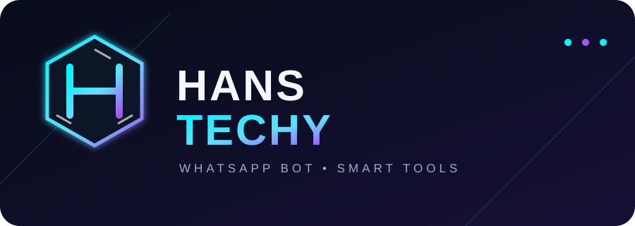

<!-- HANS TECHY README -->

<div align="center">
  

  <p><strong>WhatsApp automation • Pairing portal • AI chat commands</strong></p>

  <p>
    <a href="https://hans-techy-yjo2.onrender.com/">🌐 Live Website</a> ·
    <a href="https://whatsapp.com/channel/0029VbD2ScLBFLgS8duVme2i">📢 ONLINE SERVICES Channel</a> ·
    <a href="https://github.com/hanstechy1/HANS-TECHY">💻 Source Code</a>
  </p>
</div>

---

## ✨ About

**HANS TECHY** is a Node.js WhatsApp bot built with [Baileys](https://github.com/WhiskeySockets/Baileys). It provides a web portal for WhatsApp QR/pair-code linking and chat commands, including the optional `.gpt` command when an OpenAI API key is configured.

## 🚀 Connect WhatsApp

Open the live portal:

- **[HANS TECHY website](https://hans-techy-yjo2.onrender.com/)**
- **[Health status](https://hans-techy-yjo2.onrender.com/health)**

The QR and pair-code pages are protected by `ADMIN_TOKEN`. Open the portal and follow the private connection flow configured for your deployment. Do not place admin tokens or credentials in URLs, README files, screenshots, or public messages.

## 🧰 Commands

Send these commands to the bot in WhatsApp:

| Command | What it does |
| --- | --- |
| `.menu`, `.help` | Show the bot command menu |
| `.ping` | Check that the bot responds |
| `.alive` | Show online response and process uptime |
| `.uptime` | Show process uptime |
| `.time` | Show Tanzania time (EAT) |
| `.date` | Show the date in Tanzania |
| `.echo your message` | Repeat the supplied text |
| `.jid` | Show the current chat ID |
| `.groupinfo` | Show basic details for the current group |
| `.about` | Show information about the bot |
| `.channel` | Show the ONLINE SERVICES WhatsApp Channel link |
| `.verify` | Record your self-confirmation after following the channel |
| `.gpt your question` | Ask GPT a question (requires `OPENAI_API_KEY`) |

Only commands implemented in the current source code are available; a menu entry does not mean every planned command is implemented.

### 📢 ONLINE SERVICES Channel

[**Follow the ONLINE SERVICES WhatsApp Channel**](https://whatsapp.com/channel/0029VbD2ScLBFLgS8duVme2i)

> **Note:** Baileys cannot independently confirm whether a user follows a WhatsApp Channel. The `.verify` command records self-confirmation only. This confirmation is stored in memory and can reset when the bot restarts.

## 🖥️ Run locally

**Requirements:** Node.js 20 or later.

1. Clone the repository and install dependencies:

   ```bash
   git clone https://github.com/hanstechy1/HANS-TECHY.git
   cd HANS-TECHY
   npm install
   ```

2. Copy `.env.example` to `.env` if that file exists, or create `.env` yourself.
3. Add the environment variables listed below.
4. Start the app:

   ```bash
   npm start
   ```

5. Open `http://localhost:3000` in your browser.

Never commit `.env`, WhatsApp session files, QR codes, pairing codes, or credentials.

## ☁️ Deploy on Render

1. Sign in to [Render](https://render.com/).
2. Choose **New + → Web Service** and connect the GitHub repository `hanstechy1/HANS-TECHY`.
3. Choose the `main` branch.
4. Set the runtime to **Node**.
5. Use these commands:
   - **Build Command:** `npm install`
   - **Start Command:** `npm start`
6. Under **Environment**, add the variables from the table below. Enter secret values directly in Render; do not put them in GitHub or this README.
7. Create the service and wait for deployment to finish.
8. Open the service URL and check `/health`.
9. If you push code changes later, Render can deploy automatically if auto-deploy is enabled. Otherwise open the service and choose **Manual Deploy → Deploy latest commit**.

**Important:** The bot stores WhatsApp session data on the local filesystem by default. If the service restarts or is redeployed, that data may be lost on hosts with ephemeral disks. Configure persistent storage where supported and keep a secure backup of your session data.

## 🟣 Deploy on Heroku

Heroku hosting may require a paid plan. Heroku and Render are separate hosting services; deploying to one does not deploy to the other.

1. Sign in to [Heroku](https://www.heroku.com/).
2. Create a new app in the Heroku Dashboard.
3. In the app's **Settings → Buildpacks**, ensure the Node.js buildpack is enabled (if your deployment method requires buildpacks).
4. Connect the GitHub repository `hanstechy1/HANS-TECHY` under **Deploy → Deployment method**, or deploy using the Heroku CLI.
5. Ensure the repository has a valid `npm start` script in `package.json`. If Heroku requires a process declaration for this app, add a `Procfile` containing `web: npm start`.
6. In **Settings → Config Vars**, add the environment variables listed below. Do not put secret values in source code.
7. Deploy the `main` branch, or push your code using the method selected in Heroku.
8. Open the app and check `/health`; then test the WhatsApp connection.

**Session warning:** Heroku's filesystem is generally ephemeral. A WhatsApp session saved only to local files can disappear after a restart or redeploy. Use a suitable persistent session-storage solution before relying on the bot for continuous operation. Avoid running multiple instances that share the same WhatsApp session.

## ⚙️ Environment variables

Set these in your hosting provider's environment/configuration settings. The actual secret values must stay private.

| Variable | Required | Description |
| --- | --- | --- |
| `ADMIN_TOKEN` | Yes | Strong random secret for protected admin routes; use at least 24 characters |
| `OWNER_NUMBER` | Recommended | Bot owner's WhatsApp number in international format using digits only, without `+` or spaces |
| `OPENAI_API_KEY` | Optional | OpenAI API key used by `.gpt`; enter it only in the provider's secret environment settings |
| `OPENAI_MODEL` | No | OpenAI model name; defaults to `gpt-4o-mini` in the current code |
| `PORT` | No | HTTP port; hosting providers normally set this automatically; local default is `3000` |
| `AUTH_DIR` | No | WhatsApp auth directory; defaults to `./auth_info_baileys` |
| `LOG_LEVEL` | No | Pino log level; defaults to `warn` |

OpenAI API usage may require billing or available API credits. A ChatGPT subscription and OpenAI API billing are separate.

## 🔐 Security and limitations

- **Never publish `ADMIN_TOKEN` or `OPENAI_API_KEY`.** Do not add real secrets to README files, GitHub commits, public URLs, or screenshots.
- If an admin token or API key has been exposed, rotate it in the relevant provider's dashboard immediately.
- Share QR codes and pairing codes only with the intended account owner.
- Baileys is an unofficial WhatsApp Web library; WhatsApp protocol changes may affect connectivity.
- Persistent storage is important for WhatsApp session continuity. Back up session data securely.
- Test changes carefully and follow WhatsApp's terms and applicable laws.

---

<div align="center">
  <sub>Made with ⚡ for HANS TECHY</sub>
</div>
